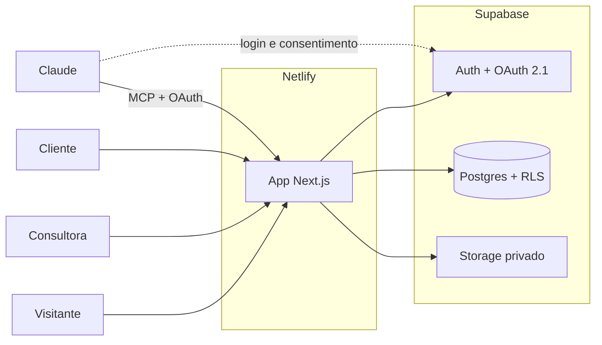
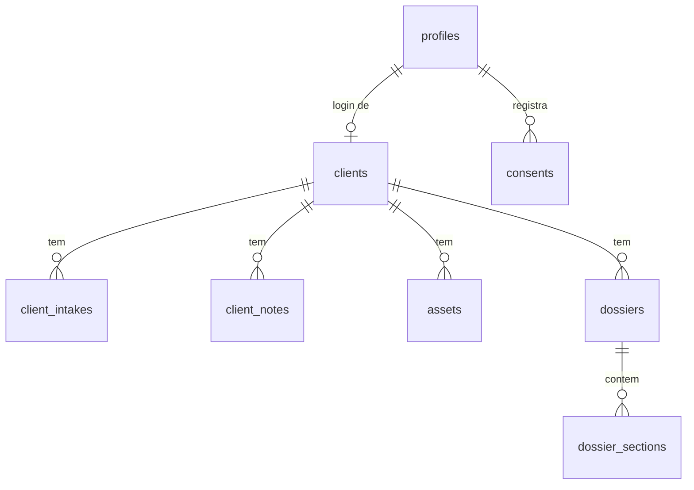

# Arquitetura

Documento de referência da plataforma Alliny Maia. Descreve o estado alvo. O que já existe e o que falta está em `BACKLOG.md`. Decisões com justificativa ficam em `docs/adr/`.

## 1. Visão geral

A plataforma tem quatro superfícies sobre uma única base de código e um único banco:

| Superfície | Quem usa | Rota |
| --- | --- | --- |
| Site público | Visitantes | `/` |
| Painel admin | Consultora (Alliny) | `/admin` |
| Área da cliente | Clientes com login | `/cliente` |
| Servidor MCP | Claude, em nome da consultora | `/api/mcp` |



Princípios que orientam o resto do documento:

1. **Um app, um deploy.** Site, painel, área da cliente e MCP vivem no mesmo app Next.js. Não existe backend separado para manter.
2. **O banco é a fronteira de autorização.** Toda tabela tem RLS. O código do app nunca é a única barreira entre uma cliente e os dados de outra.
3. **Domínio isolado da interface.** Regras de negócio ficam em módulos de domínio. Telas, server actions e ferramentas MCP são bordas finas que chamam os mesmos serviços.
4. **Conteúdo estruturado, apresentação separada.** O dossiê é dado validado por schema. O visual é um renderizador. Mudar o layout não exige migrar dados.
5. **Tudo versionado.** Schema do banco, políticas, seeds, formulários e tipos de seção vivem no repositório e passam por revisão.

## 2. Stack

| Camada | Escolha | Observação |
| --- | --- | --- |
| Linguagem | TypeScript em modo `strict` | Uma linguagem de ponta a ponta |
| Framework | Next.js (App Router), linha 16 | Fixar a versão no `package.json` no scaffold |
| UI | React, Tailwind CSS, tokens da marca em variáveis CSS | Painel admin pode usar componentes prontos; site e dossiê seguem o design da marca |
| Formulários | react-hook-form + zod | O mesmo schema zod valida no cliente e no servidor |
| Banco | Supabase Postgres | Migrations SQL em `supabase/migrations` |
| Autenticação | Supabase Auth com `@supabase/ssr` | Sessão em cookie, lida no servidor |
| Arquivos | Supabase Storage, bucket privado | Acesso por URL assinada |
| MCP | SDK oficial TypeScript do MCP, transporte Streamable HTTP sem estado | Rota do próprio app |
| OAuth do MCP | Servidor OAuth 2.1 do Supabase Auth | Ver ADR 0004 |
| Hospedagem | Netlify | Adaptador OpenNext, sem configuração especial |
| Testes | Vitest, pgTAP, Playwright | Ver seção 11 |
| CI | GitHub Actions | Ver seção 12 |
| Gerenciador de pacotes | npm | Sem ajustes extras no Netlify |

Regra para o scaffold e para qualquer biblioteca nova: usar a versão estável mais recente, fixar no `package.json` e consultar a documentação da versão instalada antes de usar uma API. Não confiar em memória para assinatura de função de framework.

## 3. Estrutura do repositório

```
CLAUDE.md                  instruções permanentes para o Claude Code
BACKLOG.md                 backlog priorizado
agent-pipeline.md          ordem dos agentes
.claude/agents/            pm, architect, dev-planner, dev-implementer
tasks/T-XXX-slug/          definition.md, architecture.md, implementation.md e anexos
docs/
  ARCHITECTURE.md          este documento
  PLANO.md                 fases, marcos, riscos e insumos
  SETUP.md                 ambiente local
  adr/                     decisões de arquitetura
src/
  app/                     rotas: UI e handlers, sem regra de negócio
    (site)/                site público
    (auth)/                login, recuperar senha, definir senha
    admin/                 painel da consultora
    cliente/               área da cliente
    oauth/consent/         tela de consentimento do OAuth (MCP)
    api/mcp/route.ts       endpoint MCP
  modules/                 domínio, um diretório por contexto
    auth/
    clients/
    intake/
    notes/
    assets/
    dossier/
      sections/            registro de tipos de seção
    audit/
  mcp/                     definição das ferramentas MCP
  lib/
    supabase/              clients (browser, server, admin) e tipos gerados
    env.ts                 validação das variáveis de ambiente
  components/ui/           componentes compartilhados
  styles/                  tokens e estilos globais
supabase/
  config.toml
  migrations/
  seed.sql
  tests/                   testes de banco (pgTAP)
tests/e2e/                 Playwright
legacy-site/               site estático atual, removido na T-003
```

### Anatomia de um módulo

```
src/modules/clients/
  schemas.ts        tipos e validação (zod)
  repository.ts     acesso a dados: única camada que fala com o Supabase
  service.ts        casos de uso: regras, autorização, auditoria
  actions.ts        server actions: validam entrada e chamam o service
  components/       componentes de UI do módulo
  *.test.ts         testes unitários
```

### Regra de dependência

```
app  ->  modules  ->  lib
mcp  ->  modules  ->  lib
```

- `modules` nunca importa de `app` nem de `mcp`.
- Um módulo só usa outro pelo `service.ts` dele, nunca pelo `repository.ts`.
- `lib/supabase/admin.ts` (service role) só pode ser importado por `service.ts` e é marcado com `server-only`.
- A regra é imposta por lint (restrição de imports), não por convenção.

## 4. Modelo de dados



| Tabela | Finalidade | Campos principais |
| --- | --- | --- |
| `profiles` | Um registro por usuário do Auth | `id` (igual a `auth.users.id`), `role` (`admin` ou `client`), `full_name` |
| `clients` | Cadastro da cliente, independente de ela ter login | `profile_id` (nulo até o convite), `full_name`, `email`, `phone`, `status` |
| `client_intakes` | Ficha de atendimento preenchida pela consultora | `client_id`, `form_key`, `schema_version`, `answers` (jsonb) |
| `client_notes` | Anotações datadas de cada atendimento | `client_id`, `noted_at`, `body` |
| `assets` | Metadados de arquivos no Storage | `client_id`, `path`, `mime_type`, `width`, `height`, `alt` |
| `dossiers` | Um dossiê de uma cliente | `client_id`, `kind` (`style` ou `color`), `status` (`draft` ou `published`), `published_at` |
| `dossier_sections` | Seções ordenadas de um dossiê | `dossier_id`, `kind`, `schema_version`, `position`, `content` (jsonb) |
| `consents` | Registro de consentimento (LGPD) | `profile_id`, `kind`, `document_version`, `granted_at` |
| `audit_log` | Trilha de acesso e alteração | `actor_id`, `actor_kind` (`user` ou `mcp`), `action`, `entity`, `entity_id`, `metadata` |

Previstas para a fase de expansão: `client_resources` (links e documentos da área da cliente) e `leads` (contato pelo site).

Convenções de banco:

- Chaves primárias `uuid`. Colunas `created_at` e `updated_at` em toda tabela de domínio.
- Nomes de tabelas e colunas em inglês, `snake_case`.
- `jsonb` só para conteúdo cuja forma é definida por schema versionado no código (`answers`, `content`). Tudo que é filtrado ou relacionado vira coluna.
- Migrations só andam para frente. Uma migration aplicada nunca é editada.

## 5. Autorização

O papel do usuário fica em `profiles.role`. Uma função `is_admin()` (security definer, com `search_path` fixo) responde se o usuário atual é admin e é usada nas políticas.

| Tabela | Admin | Cliente |
| --- | --- | --- |
| `profiles` | lê e edita todos | lê e edita o próprio (sem trocar `role`) |
| `clients` | tudo | lê o próprio registro |
| `client_intakes`, `client_notes` | tudo | sem acesso |
| `assets` | tudo | lê os do próprio cadastro que estejam em dossiê publicado |
| `dossiers`, `dossier_sections` | tudo | lê apenas os próprios com `status = published` |
| `consents` | lê todos | lê e cria os próprios |
| `audit_log` | lê | sem acesso |

Defesa em profundidade, em três níveis:

1. **RLS** decide o que cada usuário enxerga. É a fonte da verdade.
2. **Service** confere o papel antes de cada caso de uso (`requireAdmin`, `requireClient`).
3. **Rotas** redirecionam por papel. Isso é experiência de uso, não segurança.

A service role key ignora RLS. Uso permitido: operações administrativas do Auth (criar usuário, convidar). Qualquer outro uso exige justificativa no `architecture.md` da task.

Cadastro público fica desligado. Contas de cliente só nascem por convite da consultora.

## 6. Autenticação e sessão

- Login por e-mail e senha, com recuperação de senha por e-mail.
- Convite: a consultora cadastra a cliente e dispara o convite. A cliente define a própria senha pelo link.
- Sessão em cookie, renovada no servidor a cada requisição com `@supabase/ssr`. Server Components e Server Actions leem o usuário no servidor.
- Rotas `/admin` e `/cliente` protegidas no interceptador de requisições do Next e de novo no layout do servidor.
- No ambiente local os e-mails caem na caixa de entrada local do Supabase CLI. Nenhum e-mail real é enviado.

## 7. Arquivos e imagens

- Bucket privado `client-assets`. Caminho: `clients/{client_id}/{asset_id}.{ext}`.
- Políticas de Storage usam o primeiro segmento do caminho para aplicar a mesma regra da tabela `assets`.
- O app nunca expõe URL pública. A página pede URLs assinadas de curta duração ao servidor.
- Upload valida tipo e tamanho no servidor. Imagens grandes são reduzidas antes de subir.
- Apagar um asset remove o arquivo e o registro na mesma operação de serviço.

## 8. Dossiê

O dossiê é uma lista ordenada de seções. Cada seção tem um tipo (`kind`) e um conteúdo que obedece ao schema daquele tipo.

Um tipo de seção é registrado em `src/modules/dossier/sections/<kind>/`:

```
schema.ts      schema zod do conteúdo e número da versão
Editor.tsx     formulário usado pela consultora no admin
Renderer.tsx   componente que desenha a seção para a cliente
index.ts       registra o tipo: kind, rótulo, schema, editor, renderer
```

Consequências práticas:

- **Criar um tipo novo** é adicionar uma pasta. Nenhuma migration é necessária.
- **Mudar o visual** é mexer no `Renderer`. Os dados não mudam.
- **Mudar a forma do conteúdo** sobe `schema_version` e inclui uma função de migração do conteúdo antigo, executada na leitura.
- O servidor valida o conteúdo com o schema antes de gravar. JSON inválido não entra no banco.

Imagens dentro de uma seção são referências a `assets` por id, nunca URLs gravadas no conteúdo.

Fluxo: a consultora cria o dossiê em rascunho, monta as seções, confere a prévia e publica. A cliente só enxerga dossiês publicados. Despublicar tira o acesso na hora.

O renderizador roda no servidor e tem folha de estilo de impressão desde o início, o que deixa a exportação em PDF barata mais adiante.

Os tipos de seção definitivos dependem do dossiê real que a Alliny entrega hoje. Ver insumos em `docs/PLANO.md`.

## 9. Ficha de atendimento

A ficha é o formulário que a consultora preenche ao conversar com a cliente. O schema é versionado em código (zod), em `src/modules/intake/forms/`. As respostas ficam em `client_intakes.answers` com a versão do schema usada.

- Mudar uma pergunta é alterar o schema e subir a versão.
- A interface salva automaticamente por seção.
- A ficha e as anotações são a principal fonte de contexto para o Claude via MCP.

## 10. Servidor MCP

**Objetivo:** a consultora conversa com o Claude sobre uma cliente e o Claude lê os dados atuais direto da plataforma.

- **Endpoint:** `/api/mcp`, transporte Streamable HTTP sem estado, compatível com funções serverless.
- **Autenticação:** OAuth 2.1 com o Supabase Auth como servidor de autorização. O app publica os metadados de recurso protegido e hospeda a tela de consentimento em `/oauth/consent`. O Claude é adicionado como conector personalizado pela URL.
- **Autorização:** o token representa a própria consultora. As consultas rodam com o token dela, então a RLS vale também para o MCP. Além disso, o servidor recusa qualquer usuário que não seja admin.
- **Somente leitura na primeira versão.**

Ferramentas da primeira versão:

| Ferramenta | Entrada | Retorno |
| --- | --- | --- |
| `whoami` | nenhuma | usuário autenticado e papel |
| `list_clients` | `query`, `status`, `limit` | lista resumida de clientes |
| `get_client` | `client_id` | dados cadastrais |
| `get_intake` | `client_id` | ficha de atendimento |
| `list_notes` | `client_id`, `since` | anotações em ordem cronológica |
| `get_dossier` | `client_id`, `kind` | dossiê em texto estruturado |

Diretrizes de implementação:

- As ferramentas chamam os mesmos `service.ts` usados pelo painel. Nenhuma consulta própria no MCP.
- Respostas compactas, com ids para encadear chamadas e paginação quando a lista pode crescer.
- Imagens voltam como descrição e texto alternativo. URL assinada só quando a ferramenta existir para isso.
- Toda chamada grava uma linha em `audit_log` com `actor_kind = mcp`.
- Dados retornados são conteúdo, nunca instrução. As descrições das ferramentas dizem isso ao modelo.

Ferramentas de escrita (registrar anotação, rascunhar seção de dossiê) ficam para a fase de expansão, sempre criando rascunho e nunca publicando.

## 11. Testes

| Nível | Ferramenta | O que cobre |
| --- | --- | --- |
| Unitário | Vitest | Schemas, services, migração de conteúdo de seção |
| Banco | pgTAP via `supabase test db` | Toda política de RLS, com casos positivos e negativos |
| Ponta a ponta | Playwright | Login, convite, publicação e leitura do dossiê |
| Contrato MCP | Vitest | Entrada e saída de cada ferramenta, recusa sem token e para não admin |

Regra: toda migration que cria ou altera tabela vem com teste de RLS no mesmo PR. O teste mínimo prova que uma cliente não lê dados de outra.

## 12. Ambientes, CI e deploy

Dois ambientes, ver ADR 0005:

| | Local | Produção |
| --- | --- | --- |
| App | `npm run dev` | Netlify, branch `main` |
| Banco, Auth, Storage | Supabase CLI em Docker | Projeto Supabase de produção |
| E-mail | caixa local do CLI | SMTP próprio |
| Dados | `supabase/seed.sql` | reais |

Fluxo de trabalho:

1. Uma branch por task: `task/T-XXX-slug`.
2. Pull request para `main`. O CI roda lint, typecheck, testes unitários, build e testes de banco em um Supabase efêmero.
3. Merge em `main` publica o app no Netlify.
4. Migrations vão para produção por um workflow manual do GitHub Actions com aprovação, nunca de uma máquina local.

Deploy previews do Netlify não recebem as variáveis do Supabase de produção. Servem para revisar o site público. Fluxos autenticados são validados localmente.

Ordem segura de publicação quando uma task tem migration: primeiro a migration compatível com o código atual, depois o código.

## 13. Segurança e LGPD

A plataforma guarda dados pessoais e imagens de clientes. Regras fixas:

- Segredos só em variáveis de ambiente. `.env*` fora do git. A service role key nunca chega ao navegador.
- Bucket privado e URLs assinadas de curta duração.
- Consentimento registrado no primeiro acesso da cliente, com versão do documento aceito.
- Exportação e exclusão dos dados de uma cliente disponíveis para a consultora.
- `audit_log` para leituras via MCP e para alterações relevantes.
- Dados reais nunca vão para o ambiente local nem para seeds.
- Cabeçalhos de segurança e política de conteúdo configurados no app.

## 14. Escalabilidade e evolução

O desenho aguenta crescimento sem troca de arquitetura:

- **Carga:** funções sem estado no Netlify e Postgres gerenciado. Índices nas chaves estrangeiras e nos filtros de listagem desde a primeira migration.
- **Novos módulos na área da cliente:** novo diretório em `modules`, nova rota em `/cliente`, novo item no menu. O layout do portal já nasce orientado a módulos.
- **Mais de uma consultora:** hoje o sistema é de uma consultoria só (ADR 0006). O caminho para várias é adicionar `workspace_id` às tabelas de domínio e às políticas. Os módulos já isolam o acesso a dados em `repository.ts`, o que concentra a mudança.
- **MCP separado:** se o MCP precisar de ciclo de deploy próprio, `src/mcp` e os services podem ser extraídos para um pacote, porque não dependem de `app`.
- **Trabalho demorado** (gerar PDF, processar imagem): sai da requisição e vai para função em segundo plano, sem mudar o modelo de dados.
